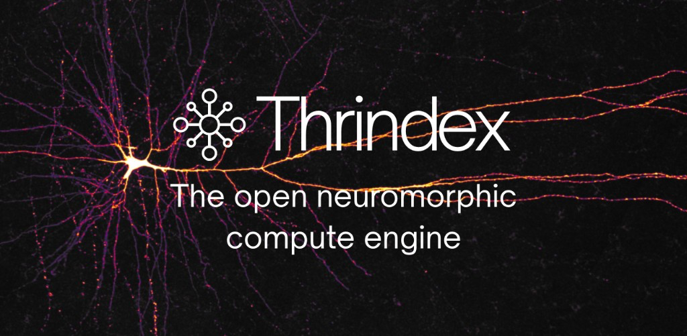

Author a model. Compile to a sealed `.thx` artifact. Run it on the behavioral simulator.

<CardGroup cols={3}>
  <Card title="Deterministic" icon="lock">
    Seeded, reproducible, CRC32-sealed. The artifact is the spec and the implementation in one file.
  </Card>
  <Card title="Energy-proportional" icon="bolt">
    Energy scales with spike count, not model size. Silent inputs cost nothing.
  </Card>
  <Card title="Sealed file" icon="file">
    `thx.compile` writes one `.thx` file. The simulator runs that file.
  </Card>
</CardGroup>

## Author, compile, run

```bash
pip install thrindex
```

```python
import thrindex as thx
import thrindex.snn as snn

model = snn.Sequential(
    snn.Dense(700, 512),
    snn.LIF(tau_mem=20.0, threshold=0.3),
    snn.Dense(512, 20),
    snn.LIF(tau_mem=20.0, threshold=0.3),
)

thx.compile(model, "model.thx")
```

```bash
thrindex run model.thx
```

## THRINDEX Certified

The conformance harness checks a model against `CONFORMANCE_ENVELOPE_V0`, the bound on how far an int8 run may diverge from the float reference simulator.

| Metric | Threshold | Meaning |
|---|---|---|
| `T_mean` | ≤ 0.020 | Mean spike-count error ≤ 2% |
| `T_max` (p99) | ≤ 0.130 | Worst-neuron error ≤ 13% |
| `P_pred` | ≥ 0.900 | ≥ 90% of predictions agree |

[Read the conformance spec →](/conformance/envelope-v0)

## What THRINDEX is not

- **Not a general-purpose framework.** Spiking neural networks: layers, training, a sealed file, and the simulator.
- **Not a black box.** Every run prints a structured transcript: spike counts, syn-ops, energy estimate.
- **Not a chip toolchain.** The `.thx` file is what the simulator runs.

<CardGroup cols={2}>
  <Card title="Get started" icon="rocket" href="/getting-started/installation">
    Install THRINDEX and run your first model in under five minutes.
  </Card>
  <Card title="Learn about SNNs" icon="brain" href="/learn/spiking-neural-networks">
    Spiking neural networks from first principles — biology, mathematics, and code.
  </Card>
</CardGroup>
